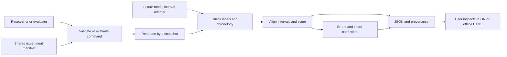

# Design and requirements traceability

This package implements Evaluation and Reporting/Export within the larger chord recognition project. The user selects annotation files or an experiment manifest, evaluates or compares predictions, inspects a recording/model/error interval and saves JSON/HTML. The actor operates a finished tool. Training and development decisions are not represented as these user operations.

This is an operational flow, not a UML Use Case diagram. The modules share immutable Segment and Annotation records. IO hashes the bytes actually parsed. Validation enforces the input contract, Evaluation delegates named chord comparisons to mir_eval, Reporting records scientific provenance and publishes complete bytes. CLI reports failures to the user.

| Assignment 2 requirement | Evidence in this module | Coverage boundary |
| --- | --- | --- |
| FR-06 Evaluate aligned annotations and export metrics | evaluation.py, reporting.py, exact-answer tests | Reference and predictions are supplied externally |
| FR-05 Valid interval output | Validation of order, positive durations and alphabet; aligned intervals in JSON | Audio inference is not implemented |
| NFR-03 Reproducibility | Input hashes, protocol, dependency/tool versions, optional code revision | Reproduces scoring, not model training |
| UR-01–02 Documented commands | validate/evaluate CLI, README and installed-wheel test | Training and audio-inference commands are outside this module |
| FR-01–04 and NFR-01–02 | Explicitly outside this package | No audio decoding, CQT, baseline/Transformer training or GPU profiling is claimed |

The restricted alphabet prevents unknown chord qualities from silently changing the score denominator. Strict coverage prevents missing predictions from being hidden by clipping or padding. Tiny boundary rounding is recorded instead of silently ignored. Saved reports never overwrite a previous run.

The scientific dependency is mir_eval 0.8.2. Its root and major/minor rules are described in the [official API](https://mir-eval.readthedocs.io/latest/api/chord.html). A broader dataset or chord vocabulary requires a new documented protocol, not merely a more permissive parser.

## Continuity audit for version 1.1

- Retains the local modular Python design, root/major-minor metrics and strict vocabulary.
- protocol.py is a shared evaluation configuration; it does not claim the full future
  training Configuration Manager has been implemented.
- API adapters separate model output formats from scoring. No model replacement
  requires a change to the common evaluator when its interval contract is met.
- One manifest fixes common recording IDs, reference snapshots, split and protocol.
  No aggregate or comparison is issued for an incomplete collection.
- Offline HTML is an exported diagnostic plot/report, within the earlier Could-have
  plots. It adds no hosted service or network architecture to the project.
- Checkpoint/configuration hashes and seeds in the manifest are declared metadata.
  Dataset splitting, training, checkpoint reload and GPU profiling remain future work.
- Predictions still require a reference for evaluation. Future inference on new
  audio is a separate operation that does not require reference annotations.

The v1.0 tests remain the regression baseline. Version 1.1 adds diagnostics,
collection orchestration, an offline report template and an API adapter module.
The [protocol](protocol.md) documents each new calculation and provenance boundary.
